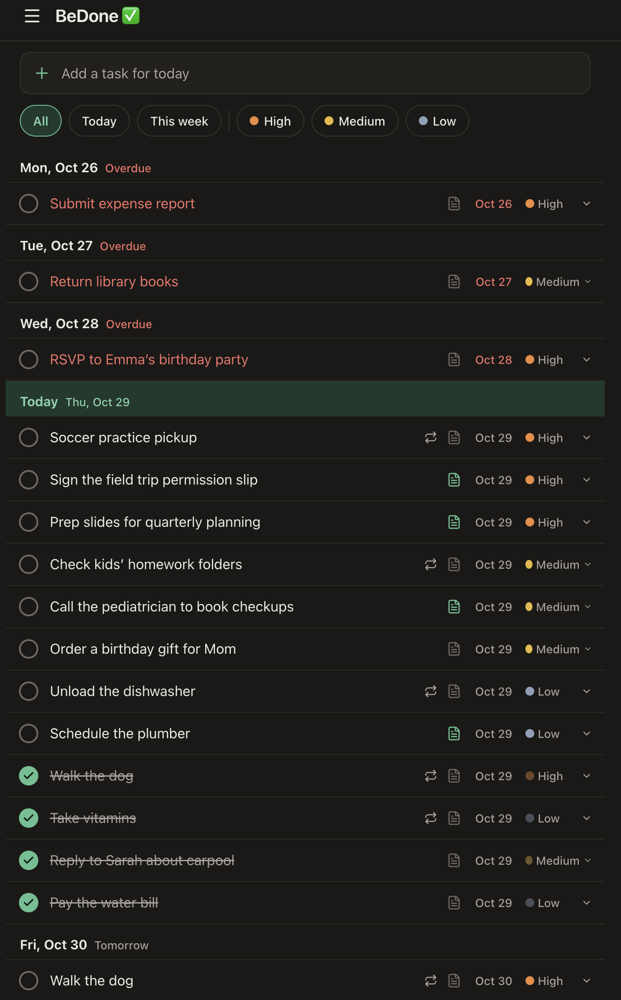
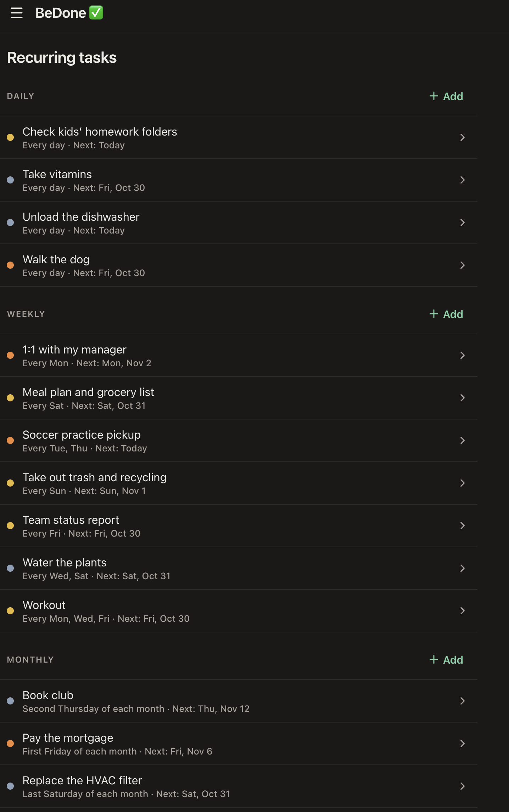

# A personal to-do app

A single-user to-do app built for daily use on a phone: tasks grouped by due
date, recurring tasks (daily, weekly, monthly), drag-and-drop rescheduling,
and rich-text notes. The app's display name is configurable; see
[Renaming the app](#renaming-the-app).

> **Status:** everything in the spec is built and tested. It is in daily
> use, self-hosted on a small Linux server. See [docs/SPEC.md](docs/SPEC.md) for
> the full specification and [docs/TODO.md](docs/TODO.md) for open items.

## Screenshots

<p>
  
  
</p>

The task list (left) and the recurring tasks screen (right), with demo data
from `npm run seed:demo`.

## Tech stack

- **Backend:** [PocketBase](https://pocketbase.io) (database, auth, realtime,
  server-side hooks)
- **Frontend:** Svelte 5 + Vite + TypeScript, built as a static app that
  PocketBase serves from `pb_public`
- **Tests:** Vitest (unit and integration), Playwright (end-to-end)

## Prerequisites

- Node.js 24 or newer (the version used in CI is in `.nvmrc`)
- macOS or Linux (for the PocketBase download script)

## Setup

```sh
npm install
cp .env.example .env
npm run pb:setup  # downloads the pinned PocketBase binary into ./pocketbase
```

## Local development

The first time, create an admin (superuser) account **before** starting
PocketBase. (If no superuser exists, PocketBase opens a browser tab with its
setup page every time it starts.)

```sh
./pocketbase superuser upsert you@example.com 'a-strong-password'
```

Then start PocketBase. It applies the migrations in `pb_migrations/`
automatically and loads the hooks in `pb_hooks/`:

```sh
npm run pb:serve  # http://127.0.0.1:8090 (admin dashboard at /_/)
```

Open http://127.0.0.1:8090/_/, sign in, and add a record to the **users**
collection with your email and password. Public sign-up is disabled, so
this is the only way to create an account.

Local data lives in `pb_data/` (git-ignored). Delete it to start over.

### Demo data

To fill an account with realistic sample tasks (for screenshots or trying
the app out), create a user in the dashboard, then, with PocketBase running:

```sh
DEMO_EMAIL=demo@example.com DEMO_PASSWORD='its-password' npm run seed:demo
```

Dates are relative to today. It won't run on an account that already has
tasks; delete and recreate the user to start over.

To work on the frontend with hot reload, run this alongside `pb:serve`:

```sh
npm run dev       # Vite dev server; talks to PocketBase at VITE_PB_URL
```

## How the backend is organized

- `pb_migrations/`: the database schema, as PocketBase migrations. The
  database can be rebuilt from scratch from these.
- `pb_hooks/tasks.pb.js`: hooks and custom API routes. Anything that
  touches more than one record (completing a recurring task, reopening it,
  deleting a recurring rule) runs in a single transaction:
  - `POST /api/tasks/{id}/complete`
  - `POST /api/tasks/{id}/uncomplete`
  - `POST /api/recurring-rules/{id}/delete`
- `pb_hooks/lib/service.js`: the logic those hooks and routes call.
- `src/lib/recurrence/`: the date and recurrence calculations, shared by the
  frontend and the hooks. `npm run build:hooks` bundles them into
  `pb_hooks/generated/shared.cjs` (git-ignored; `pb:serve`, `build` and the
  integration tests build it for you).

## Testing

```sh
npm test                  # unit tests (Vitest)
npm run test:integration  # API rules and recurrence, against a real PocketBase
npm run test:e2e          # end-to-end and accessibility (Playwright): iPhone/WebKit + desktop Chromium
npm run check             # type checks
npm run test:all          # all of the above
```

The first time, install the browsers Playwright uses:

```sh
npx playwright install webkit chromium
```

Integration and end-to-end tests start their own PocketBase on a temporary
database, so they never touch `pb_data/`. End-to-end tests run against the
built app (`test:e2e` builds it first).

## Building

```sh
npm run build     # frontend into pb_public/, hooks bundle into pb_hooks/generated/
```

## Deployment

The app is a single PocketBase process that serves both the API and the
built frontend, so any Linux server that can run one binary will do. These
steps self-host it on an Ubuntu server, with [Caddy](https://caddyserver.com)
in front for automatic HTTPS. Deployment is manual.

In the commands below, replace `you@your-server` with your SSH login and
`todo.example.com` with your domain. Example config files are in
[`deploy/`](deploy/).

### One-time server setup

1. Point a DNS A record for `todo.example.com` at the server, and allow
   ports 80 and 443 through the firewall.
2. [Install Caddy](https://caddyserver.com/docs/install).
3. Download the Linux build of PocketBase into `/opt/bedone`. Use the
   version pinned in `scripts/setup-pocketbase.sh`, and `arm64` instead of
   `amd64` on an ARM server:

   ```sh
   VERSION=0.40.6
   sudo mkdir -p /opt/bedone && sudo chown "$USER": /opt/bedone
   cd /opt/bedone
   curl -fsSLO "https://github.com/pocketbase/pocketbase/releases/download/v${VERSION}/pocketbase_${VERSION}_linux_amd64.zip"
   unzip "pocketbase_${VERSION}_linux_amd64.zip" pocketbase && rm "pocketbase_${VERSION}_linux_amd64.zip"
   ```

4. Install the service: copy [`deploy/bedone.service`](deploy/bedone.service)
   to `/etc/systemd/system/bedone.service` on the server, set `User` and
   `Group` to the account that owns `/opt/bedone`, then:

   ```sh
   sudo systemctl daemon-reload
   sudo systemctl enable bedone
   ```

5. Add the block from [`deploy/Caddyfile.example`](deploy/Caddyfile.example)
   to `/etc/caddy/Caddyfile` and run `sudo systemctl reload caddy`.
6. Create the admin (superuser) account before the first start:

   ```sh
   /opt/bedone/pocketbase superuser upsert you@example.com 'a-strong-password' --dir=/opt/bedone/pb_data
   ```

   To move existing local data instead, stop your local PocketBase and copy
   `pb_data/` to `/opt/bedone/` once, before the first start.

### Deploying (first time and every update)

From your machine, in the repo:

```sh
npm run build
rsync -avz --delete pb_public pb_hooks pb_migrations you@your-server:/opt/bedone/
ssh -t you@your-server sudo systemctl restart bedone
```

PocketBase applies any new migrations when it starts. Check that it's
running with `sudo systemctl status bedone`, and see its logs with
`sudo journalctl -u bedone`.

After the first deploy, sign in to `https://todo.example.com/_/` and:

1. Create your account in the **users** collection (skip this if you copied
   your local `pb_data/`).
2. Go to **Settings → Application → User IP proxy headers**, add
   `X-Forwarded-For`, and save. Caddy passes each visitor's real address in
   that header; without it, PocketBase logs every request as coming from
   `127.0.0.1`, and any rate limits you enable would apply to everyone at
   once.

> **Never upload `pb_data/` after the first start.** The server holds the
> live data. Your local `pb_data/` is a development sandbox, and syncing it
> would overwrite everything on the server.

### Backups

PocketBase has built-in scheduled backups: in the admin dashboard, go to
**Settings → Backups**. Note that the server's clock is usually UTC when
setting the schedule.

## Renaming the app

The name and emoji are defined in one place, `APP` in
[`src/lib/config.ts`](src/lib/config.ts):

```ts
export const APP = {
  name: 'Your App Name',
  emoji: '📝',
} as const;
```

Change those two values and rebuild. The header, the page title, and
everything else read from this constant. Set `emoji` to `''` to drop it.

## License

[MIT](LICENSE)
